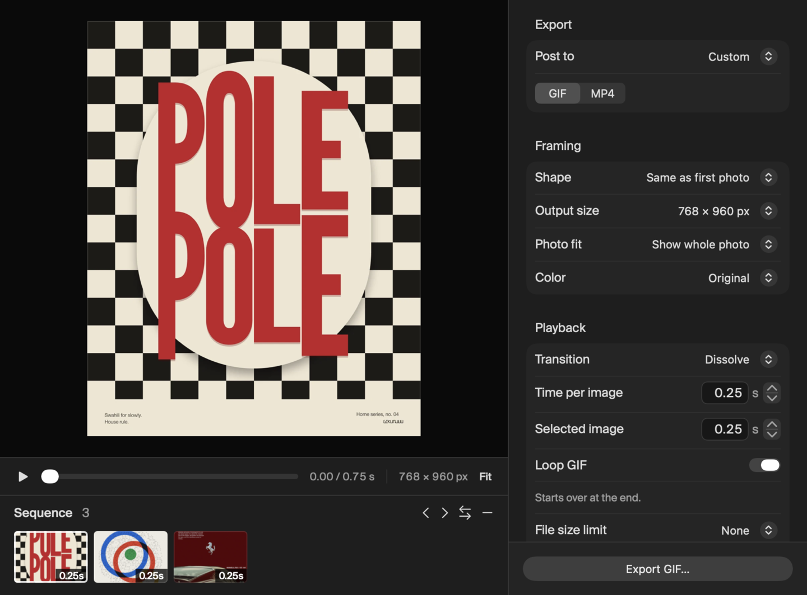

# Guks Studio

A macOS app for turning photos into looping GIFs and H.264 MP4s. Import photos or folders, drag to reorder, preview your sequence, and export with custom timing, crops, and transitions.



Artwork from [Gikunju’s Playground](https://www.gikunju.design/playground).

Requires macOS 13 or later. The build script uses Apple’s command-line developer tools and produces a universal app for Apple silicon and Intel Macs.

## Build

```sh
./build.sh
```

Open `build/Guks Studio.app` when the build finishes.
